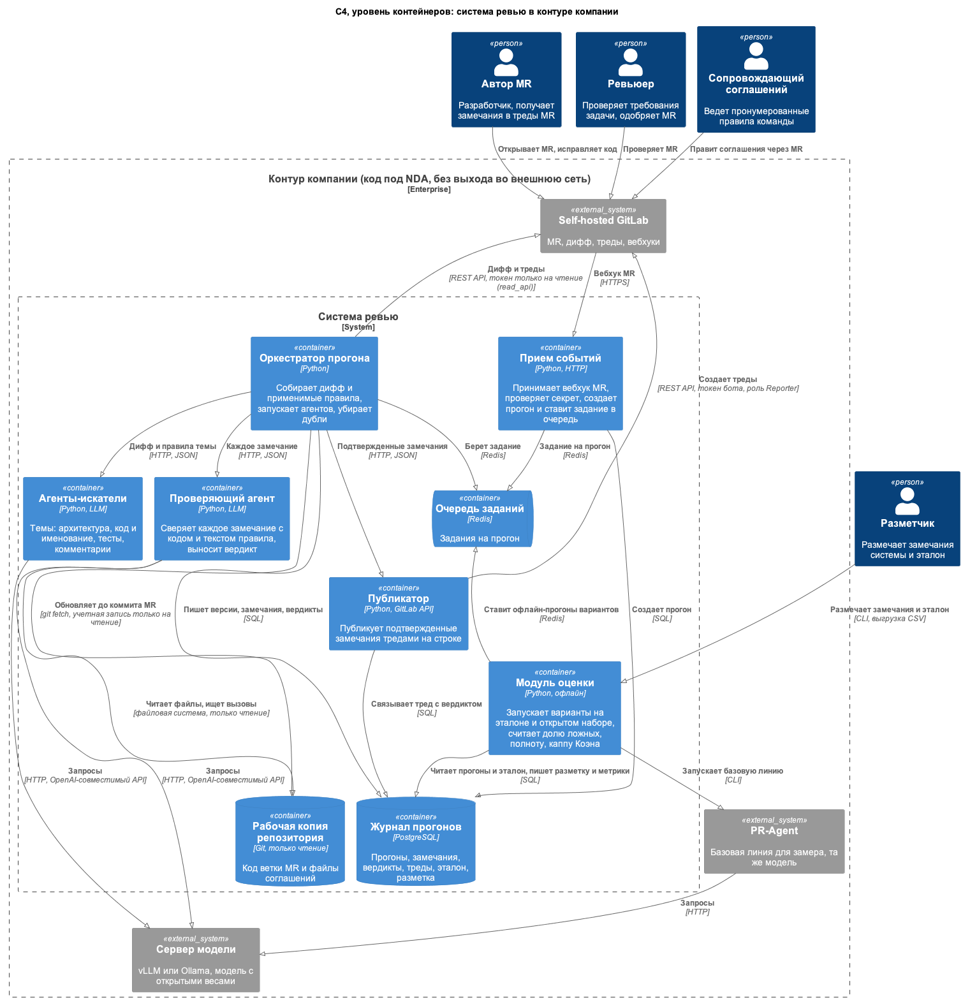
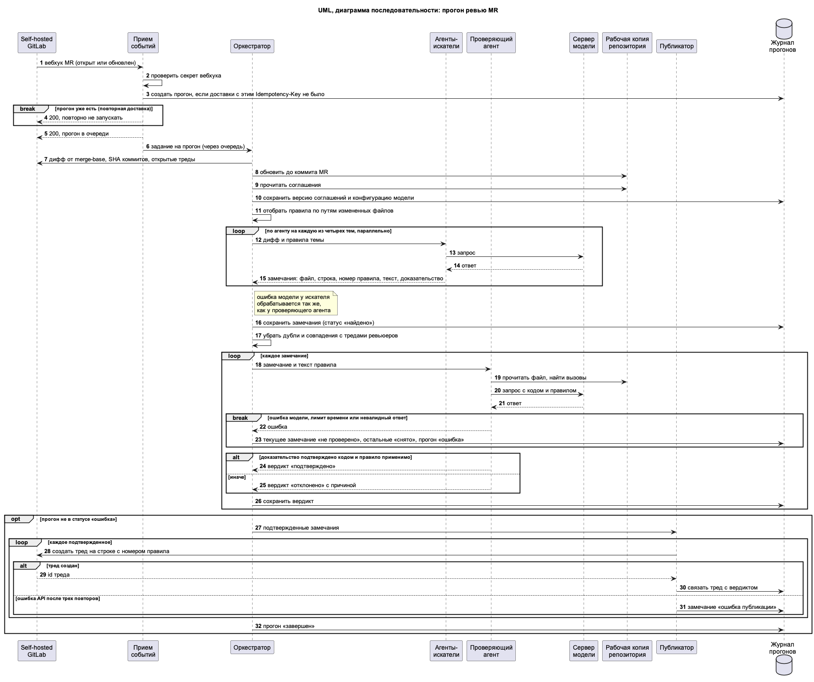
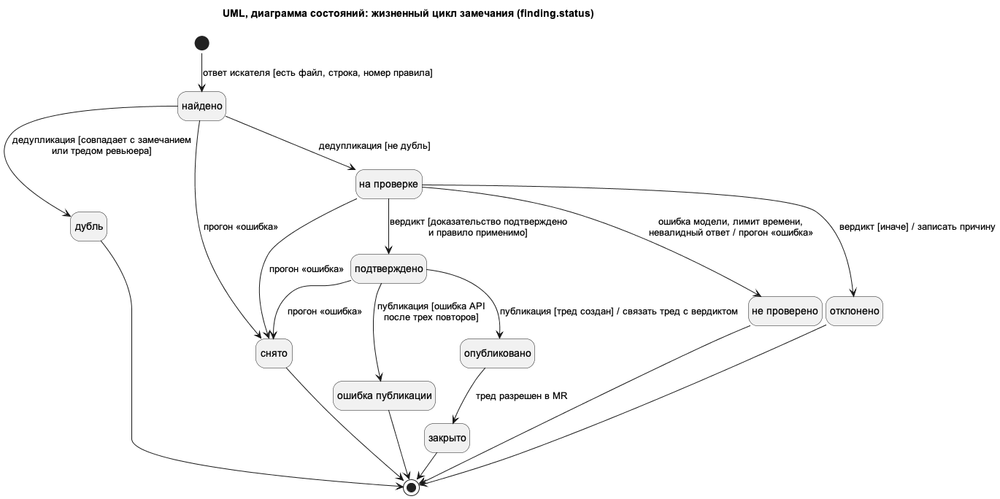
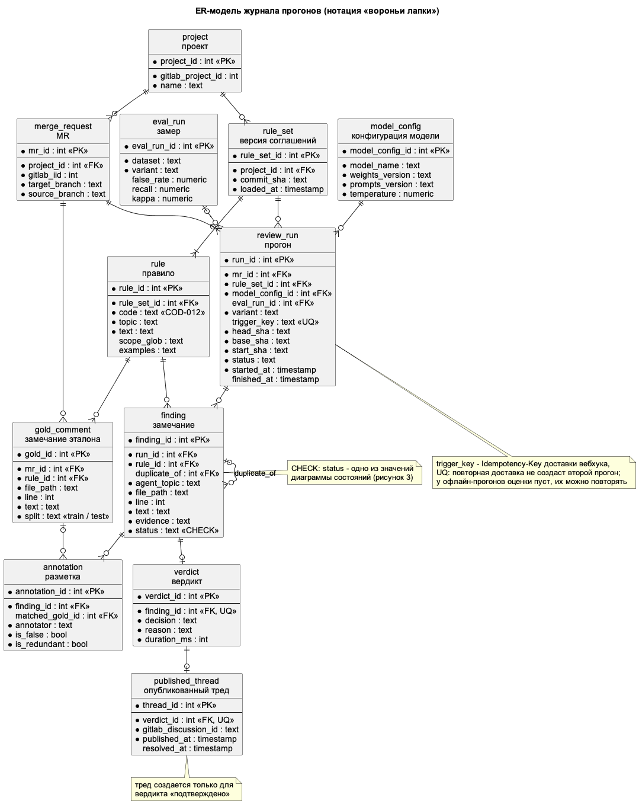
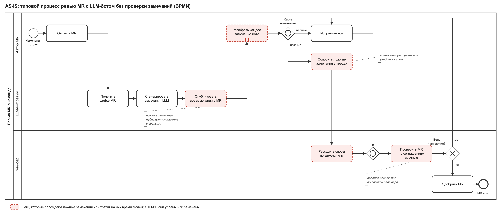
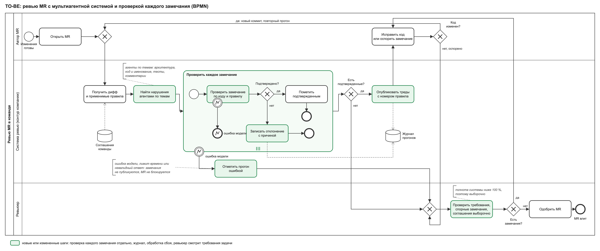

# ЛР 3 – проектирование

**Тема ВКР:** Разработка мультиагентной системы автоматизированного ревью кода на основе больших языковых моделей с проверкой замечаний на соответствие соглашениям команды разработки

**Автор:** Соболь Владимир Вячеславович, группа K3440 (GitHub: [vovasobol1](https://github.com/vovasobol1))

**Руководитель темы:** не назначен

**Вид работы:** индивидуальная

**Материалы:** отчет – `docs/design/report.md`, диаграммы – `assets/*.png`, исходники диаграмм – `assets/src/` (PlantUML и генератор BPMN на Python).

## Список сокращений и условных обозначений

БД – база данных\
ВКР – выпускная квалификационная работа\
ГОСТ – государственный стандарт\
ИСО – Международная организация по стандартизации\
ЛР – лабораторная работа\
МЭК – Международная электротехническая комиссия\
ПО – программное обеспечение\
СУБД – система управления базами данных\
API – Application Programming Interface, программный интерфейс\
AS-IS – модель текущего состояния процесса\
BPMN – Business Process Model and Notation, нотация моделирования бизнес-процессов\
C4 – модель архитектуры ПО из четырех уровней: контекст, контейнеры, компоненты, код\
CHECK – ограничение SQL на допустимые значения столбца\
DFD – Data Flow Diagram, диаграмма потоков данных\
DMN – Decision Model and Notation, нотация моделирования решений\
eEPC – extended Event-driven Process Chain, расширенная событийная цепочка процессов\
EPC – Event-driven Process Chain, событийная цепочка процессов\
ER – Entity-Relationship, модель «сущность – связь»\
FEEL – Friendly Enough Expression Language, язык выражений DMN\
FK – Foreign Key, внешний ключ\
FR – Functional Requirement, функциональное требование\
HTTP – Hypertext Transfer Protocol, протокол передачи гипертекста\
HTTPS – HTTP Secure, HTTP с шифрованием\
ID – identifier, идентификатор требования\
IDEF – Integration Definition, семейство методологий моделирования\
LLM – Large Language Model, большая языковая модель\
MR – merge request, запрос на слияние изменений в GitLab\
NDA – Non-Disclosure Agreement, соглашение о неразглашении\
NFR – Non-Functional Requirement, нефункциональное требование\
OMG – Object Management Group, консорциум разработчиков стандартов моделирования\
PK – Primary Key, первичный ключ\
PR – pull request, запрос на слияние изменений в GitHub\
REST – Representational State Transfer, архитектурный стиль HTTP API\
SHA – Secure Hash Algorithm, алгоритм хеширования; в Git хеш SHA идентифицирует коммит\
SQL – Structured Query Language, язык запросов к реляционной БД\
TO-BE – модель целевого состояния процесса\
UML – Unified Modeling Language, унифицированный язык моделирования\
UQ – unique, уникальный ключ\
XML – Extensible Markup Language, расширяемый язык разметки

## 1 Предметная область и требования

### 1.1 Описание предметной области

Система проверяет MR в команде, у которой есть пронумерованные соглашения о коде: правила об архитектуре, коде и именовании, тестах и комментариях. Код коммерческого проекта находится под NDA, хранится в self-hosted GitLab и не может отправляться внешним сервисам, поэтому система и модель работают внутри контура компании.

Участники процесса:

- автор MR – разработчик, который открывает MR и исправляет код по замечаниям;
- ревьюер – разработчик, который проверяет MR и одобряет слияние;
- сопровождающий соглашений – тимлид, который ведет текст правил в репозитории;
- разметчик – участник оценки качества, который размечает замечания системы как ложные или верные и собирает эталон.

LLM-ревьюеры, которые подключают к MR, обычно публикуют все найденные замечания. Больше половины замечаний агентного ревью CodeRabbit разработчики отклоняют, в том числе как ложные [1], а при промышленном внедрении ревью на основе PR-Agent среднее время закрытия PR выросло с 5 ч 52 мин до 8 ч 20 мин [2]. Ложное замечание тратит время автора на разбор и ответ и время ревьюера на разрешение спора.

Прототип автора, описанный в ЛР 2, сейчас запускает сам ревьюер: агенты пишут черновик замечаний, и ревьюер вручную решает, что из него опубликовать. Как процесс команды он не внедрен. Поэтому в качестве AS-IS в разделе 5 взят типовой процесс команды, подключившей LLM-бота без проверки замечаний, как в [2]: именно такой процесс заменяет проектируемая система.

Система поддерживает два процесса:

1) ревью MR: агенты по темам ищут нарушения соглашений, проверяющий агент сверяет каждое замечание с кодом и текстом правила, в MR публикуются только подтвержденные замечания;
2) оценку качества: прогон вариантов системы на эталоне из замечаний живых ревьюеров и расчет доли ложных замечаний и полноты.

Схема «агенты-искатели, затем проверяющий агент» взята из аналогов, разобранных в ЛР 2 [3], но перенесена в self-hosted GitLab и дополнена проверкой по тексту правила команды.

### 1.2 Функциональные требования

Функциональные требования приведены в таблице 1. Идентификаторы FR используются в разделах 3–6.

Таблица 1 – Функциональные требования

| ID | Требование | Как проверить выполнение |
|---|---|---|
| FR-01 | Система запускает прогон ревью по вебхуку GitLab при открытии MR и при новом коммите в нем. Повторная доставка вебхука для того же коммита не создает второй прогон | Интеграционный тест: два одинаковых вебхука, в том числе одновременных, дают одну запись прогона в журнале |
| FR-02 | Система получает дифф MR относительно merge-base, открытые треды ревьюеров и соглашения из репозитория и передает агентам только правила, область действия которых совпадает с путями измененных файлов | Тест на MR, который меняет только тесты: агентам переданы правила о тестах и общие правила, остальные нет |
| FR-03 | Агенты-искатели по темам (архитектура, код и именование, тесты, комментарии) возвращают замечания с полями: файл, строка, номер правила, текст, доказательство в виде фрагмента кода. Замечание без номера правила или с номером, которого нет в соглашениях, отбрасывается | Проверка схемы ответа агента; по журналу все сохраненные замечания ссылаются на существующее правило |
| FR-04 | Система убирает дубли: одинаковые замечания разных агентов и замечания, совпадающие с открытыми тредами ревьюеров (тот же файл, близкая строка, то же правило) | Тест на MR с заранее созданным тредом ревьюера: система не создает повторный тред |
| FR-05 | Проверяющий агент сверяет каждое замечание с кодом рабочей копии репозитория и с текстом правила и выносит вердикт «подтверждено» или «отклонено» с причиной | Тест: у каждого замечания прогона есть вердикт или статус «не проверено». Эффект проверки меряется на эталоне: доля ложных замечаний ниже, чем у системы без проверяющего агента; рабочая гипотеза из ЛР 2 – не менее чем в 1,5 раза, уточняется замером |
| FR-06 | Подтвержденные замечания публикуются тредами на строке диффа на русском языке с номером правила | Сверка API GitLab и журнала: у каждого треда бота есть вердикт «подтверждено» |
| FR-07 | Система ведет журнал прогона: замечания, вердикты с причинами, опубликованные треды, версии модели, промптов и соглашений | По любому треду бота из журнала восстанавливаются прогон, правило, вердикт и версии |
| FR-08 | Модуль оценки прогоняет варианты системы (полная, без проверяющего агента, одноагентная, PR-Agent с той же моделью) на эталоне и открытом наборе и считает долю ложных замечаний, полноту и каппу Коэна для разметки | Отчет замера содержит три показателя для каждого варианта и набора данных |

### 1.3 Нефункциональные требования

Нефункциональные требования приведены в таблице 2. Каждому требованию сопоставлена характеристика качества по ГОСТ Р ИСО/МЭК 25010-2015 [4].

Таблица 2 – Нефункциональные требования

| ID | Требование | Характеристика качества | Как проверить выполнение |
|---|---|---|---|
| NFR-01 | Код, дифф и соглашения не покидают контур компании: агенты обращаются только к серверу модели внутри контура, сетевая политика разрешает сервису только соединения с GitLab и сервером модели | Защищенность, конфиденциальность | Аудит конфигурации и журнала исходящих соединений за период пилота: ноль адресов вне контура |
| NFR-02 | 90 % прогонов для MR до 1000 измененных строк завершаются не позже чем через 15 мин после вебхука | Уровень производительности, временные характеристики | Расчет 90-го процентиля по полям начала и конца прогона в журнале |
| NFR-03 | Непроверенное замечание не публикуется: при ошибке модели, превышении лимита времени или невалидном ответе прогон завершается ошибкой без публикации. Сбой системы не блокирует слияние MR | Надежность, отказоустойчивость | Тест с остановленным сервером модели: ноль тредов в MR, прогон в статусе «ошибка», MR можно влить |
| NFR-04 | Каждый опубликованный тред прослеживается до прогона, правила и вердикта; в прогоне фиксируются версия весов, версия промптов, коммит соглашений и температура | Защищенность, отслеживаемость | Запрос к журналу: 100 % тредов бота связаны с вердиктом и прогоном с заполненными версиями |
| NFR-05 | Минимальные права: чтение из GitLab – токеном только на чтение, публикация – токеном бота с ролью не выше Reporter; рабочая копия репозитория только для чтения; у агентов нет инструментов записи и запуска кода; вебхук без верного секрета отклоняется | Защищенность, целостность | Проверка прав токенов; тест вебхука с неверным секретом; попытка записи в рабочую копию завершается ошибкой |
| NFR-06 | Повторный прогон того же коммита с теми же версиями дает тот же набор опубликованных правил по тем же строкам не менее чем в 90 % случаев | Надежность, зрелость | Двойной прогон выборки MR и сравнение наборов «файл, строка, правило» |

**Обоснование значений.** NFR-01 и NFR-05 следуют из условий целевой среды: код под NDA, а экспертиза исходного кода по ГОСТ Р 56939-2024 проводится в процессах самого разработчика [5]. NFR-03 следует из цели ВКР: лучше не опубликовать верное замечание, чем опубликовать непроверенное. Значения в NFR-02 и NFR-06 – рабочие, уточняются замером. Для NFR-02 ориентир такой: в Google медианная задержка всего процесса ревью меньше 4 ч [6], и прогон должен занимать малую долю этого времени, чтобы замечания системы появились до того, как ревьюер возьмет MR. Для NFR-06 допуск в 10 % нужен потому, что ответы LLM могут различаться между запусками. NFR-04 и NFR-06 нужны для оценки: без версий и повторяемости нельзя сравнить варианты системы в задаче 5 из ЛР 2.

## 2 Обзор нотаций и видов диаграмм

Описание архитектуры по ГОСТ Р 57100-2016 состоит из нескольких представлений, каждое из которых отвечает на интересы определенных заинтересованных сторон [7]. Поэтому сначала рассмотрены нотации, которые описывают разные стороны системы: процессы, функции, данные, взаимодействия, архитектуру и правила принятия решений. Обзор приведен в таблице 3.

Таблица 3 – Обзор нотаций и видов диаграмм

| Нотация или вид диаграммы | Что описывает | Сильные стороны |
|---|---|---|
| BPMN [8] | Процессы: последовательность задач участников, события, ветвления, обмен сообщениями | Пулы и дорожки показывают, кто выполняет шаг; шлюзы, подпроцессы и граничные события показывают ветвления, повторения и исключения; стандарт OMG с форматом обмена XML; понятна и аналитикам, и разработчикам; удобна для AS-IS и TO-BE |
| IDEF0 [9] | Функции: что делает система, с входами, выходами, управлением и механизмами | Иерархическая декомпозиция от контекстной диаграммы; явно видно, что управляет функцией (например, соглашения) и кто ее выполняет; российские рекомендации по стандартизации |
| IDEF3 [10] | Процессы и смена состояний объектов: порядок единиц работы и перекрестки И, ИЛИ, исключающее ИЛИ | Описывает сценарии со слов экспертов; схема переходов состояний показывает, как меняется объект в процессе |
| DFD [11] | Потоки данных между процессами, внешними сущностями и хранилищами | Показывает, откуда и куда идут данные, без порядка выполнения; хорошо выявляет хранилища и границы системы |
| ER-модель [12, 13] | Данные: сущности, атрибуты, связи и кратности | Не зависит от СУБД; кратности связей фиксируют ограничения целостности; напрямую переводится в схему реляционной БД |
| UML: вариантов использования [14] | Взаимодействия акторов с системой на уровне целей | Быстро фиксирует границу системы и роли; удобна для согласования охвата |
| UML: классов [14] | Структура: классы, атрибуты, операции, связи | Связывает модель предметной области с кодом; подходит для объектного проектирования |
| UML: последовательности [14] | Взаимодействия: порядок сообщений между участниками во времени | Фрагменты alt, loop, par и break показывают ветвления, циклы, параллельность и обработку ошибок; видно, какой компонент к какому обращается |
| UML: активности [14] | Процессы и алгоритмы: действия, ветвления, параллельные потоки | Подходит для алгоритма внутри компонента; дорожки разделяют ответственность |
| UML: состояний [14] | Поведение объекта: состояния и переходы в форме «событие [условие] / действие» | Явно показывает допустимые и недопустимые переходы, из которых получаются проверки в коде и тесты |
| UML: компонентов и развертывания [14] | Архитектуру: компоненты, интерфейсы, узлы и размещение на них | Точное описание интерфейсов и инфраструктуры развертывания |
| C4 [15] | Архитектуру ПО на четырех уровнях: контекст, контейнеры, компоненты, код | Минимум элементов; на связях подписаны протоколы и технологии; границы систем видны на схеме, поэтому ее понимают и не архитекторы |
| EPC [16] | Процессы как чередование событий и функций с логическими операторами | Явные события перед функциями и после них; в расширенной eEPC к функциям прикрепляются исполнители и данные |
| DMN [17] | Правила принятия решений: требования к решению и таблицы решений | Отделяет логику решений от процесса; таблицы решений проверяются на полноту и противоречия; выражения на языке FEEL |
| ArchiMate [18] | Архитектуру предприятия: бизнес-процессы, приложения и технологии и связи между слоями | Связывает цели организации с приложениями и инфраструктурой на одном языке |

## 3 Выбор нотаций для проекта

Для ВКР выбраны четыре нотации: BPMN, C4, UML (диаграммы последовательности и состояний) и ER-модель. Связь выбора с требованиями приведена в таблице 4.

Таблица 4 – Выбранные нотации и связанные требования

| Нотация или вид диаграммы | Что моделируем | Связанные требования | Почему подходит |
|---|---|---|---|
| BPMN | Бизнес-логику: процесс ревью MR с участием автора, системы и ревьюера; AS-IS и TO-BE | FR-01, FR-03, FR-05, FR-06, FR-07, NFR-03 | Дорожки показывают, кто тратит время на ложное замечание; многократный подпроцесс со шлюзом «Подтверждено?» показывает решение по каждому замечанию; граничное событие ошибки показывает отказ без публикации; ветка «оспорено» ведет к ревьюеру, поэтому система не блокирует слияние |
| C4, уровень контейнеров | Взаимодействие компонентов и потоки данных, границы контура компании | FR-01, FR-02, FR-05, FR-06, FR-08, NFR-01, NFR-05 | Граница «Контур компании» показывает, что сервер модели и GitLab внутри контура (NFR-01); на связях указаны протоколы и права токенов (NFR-05) |
| UML: последовательности и состояний | Поведение прогона во времени и жизненный цикл замечания | FR-01–FR-07, NFR-03, NFR-05 | Фрагменты break, loop, alt и opt показывают идемпотентность вебхука, параллельный запуск агентов и отказ без публикации; диаграмма состояний показывает, что в «опубликовано» ведет только переход из «подтверждено» |
| ER-модель | Структуру данных и модель БД журнала прогонов | FR-01, FR-07, FR-08, NFR-04, NFR-06 | Уникальный ключ доставки вебхука в прогоне обеспечивает идемпотентность; цепочка «замечание – вердикт – тред» с кратностями 1:0..1 запрещает тред без вердикта; поля версий обеспечивают прослеживаемость и повторяемость |

**Какие нотации отражают бизнес-логику.** BPMN: процесс ревью – это работа нескольких людей и системы с ветвлениями «какие замечания?» и «есть замечания?», и BPMN показывает их явно вместе с исполнителями. EPC и IDEF3 описывают те же процессы, но исполнитель в eEPC прикрепляется к каждой функции отдельно, а в IDEF3 его нет, поэтому вопрос «у кого уходит время на ложное замечание» читается хуже, чем по дорожкам BPMN. IDEF0 не показывает порядок шагов и ветвления, а ради них и делается сравнение AS-IS и TO-BE.

**Какие нотации отражают структуру данных и модель БД.** ER-модель: журнал прогонов – реляционная БД, а модель «сущность – связь» напрямую переводится в таблицы. Диаграмма классов UML дала бы операции, которых у журнала нет.

**Какие нотации отражают взаимодействие компонентов и потоки данных.** C4 на уровне контейнеров показывает, какие процессы и хранилища есть в системе и по каким протоколам они связаны. DFD показала бы те же потоки, но без технологий и без границы контура, которая важна для NFR-01. UML-диаграмма последовательности добавляет порядок сообщений и обработку ошибок, которых нет ни в C4, ни в DFD.

**Почему не выбраны остальные.** Диаграмма вариантов использования покрыта участниками на C4 и дорожками BPMN. DMN не подходит для вердикта проверяющего агента: вердикт выносит LLM по тексту правила и коду, а не таблица решений с перечислимыми условиями. ArchiMate избыточен для одной системы без связи с архитектурой предприятия.

Таблица 5 показывает, какой элемент какой модели отражает каждое требование. Номера сообщений соответствуют автоматической нумерации на рисунке 2.

Таблица 5 – Отражение требований в моделях

| Требование | C4 (рисунок 1) | Последовательность (рисунок 2) | Состояния (рисунок 3) | ER (рисунок 4) | BPMN TO-BE (раздел 5) |
|---|---|---|---|---|---|
| FR-01 | Связь «Вебхук MR» к «Приему событий», связи «Создает прогон» и «Задание на прогон» через очередь | Сообщения 1–6, фрагмент break | – | Уникальный `review_run.trigger_key` | Шлюз после «Открыть MR», поток «новый коммит, повторный прогон» |
| FR-02 | Связи оркестратора с GitLab и рабочей копией | Сообщения 7–11 | – | `rule.scope_glob`, `rule_set.commit_sha` | Задача «Получить дифф и применимые правила», хранилище «Соглашения команды» |
| FR-03 | Контейнер «Агенты-искатели» | Параллельный loop, сообщения 12–15 | Переход в «найдено» с условием | `finding.rule_id`, `finding.evidence` | Задача «Найти нарушения агентами по темам» |
| FR-04 | Контейнер «Оркестратор прогона» | Сообщение 17 | Состояние «дубль» | Связь `finding.duplicate_of` | – |
| FR-05 | Контейнер «Проверяющий агент», связь с рабочей копией | Фрагмент loop, сообщения 18–21, 24–26 | Переходы из «на проверке» | Сущность `verdict` | Подпроцесс «Проверить каждое замечание», шлюз «Подтверждено?» |
| FR-06 | Контейнер «Публикатор», связь «Создает треды» | Сообщения 27–31 | «подтверждено» → «опубликовано» | Сущность `published_thread` | Шлюз «Есть подтвержденные?», задача «Опубликовать треды с номером правила» |
| FR-07 | Контейнер «Журнал прогонов» | Записи в журнал: 3, 10, 16, 23, 26, 30–32 | Действие «записать причину» | Сущности `review_run`, `rule_set`, `model_config` | Задача «Записать отклонение с причиной», хранилище «Журнал прогонов» |
| FR-08 | Контейнер «Модуль оценки», PR-Agent, разметчик | – | – | Сущности `gold_comment`, `annotation`, `eval_run` | – |
| NFR-01 | Граница «Контур компании», GitLab и сервер модели внутри нее | – | – | – | Дорожка «Система ревью (контур компании)» |
| NFR-02 | Агенты – отдельные контейнеры | Параллельный loop агентов | – | `started_at`, `finished_at` | – |
| NFR-03 | Публикатор получает только подтвержденные замечания | Фрагмент break, сообщения 22–23, фрагмент opt вокруг публикации | Состояния «не проверено» и «снято» без перехода к публикации | `review_run.status` | Граничное событие «ошибка модели», задача «Отметить прогон ошибкой», путь к ревьюеру; ветка «нет, оспорено» |
| NFR-04 | – | Сообщения 10, 30 | Действие «связать тред с вердиктом» | Цепочка `finding` – `verdict` – `published_thread` | – |
| NFR-05 | Подписи «токен только на чтение», «роль Reporter», «только чтение» | Сообщение 2 (проверка секрета) | – | – | – |
| NFR-06 | – | Сообщение 10 | – | `model_config`, `rule_set.commit_sha` | – |

## 4 Модели системы

### 4.1 Архитектура: C4, уровень контейнеров

Архитектура системы на уровне контейнеров показана на рисунке 1.

Рисунок 1 – Контейнеры системы ревью в контуре компании (C4)

**Пояснение модели.** Система состоит из шести исполняемых контейнеров, очереди заданий и двух хранилищ. Контейнеры обмениваются данными по HTTP и через очередь. «Прием событий» отвечает GitLab сразу, создает прогон и ставит задание в очередь, откуда его берет оркестратор: GitLab требует быстрого ответа на вебхук и может доставить событие повторно [19]. «Оркестратор прогона» собирает контекст и управляет агентами. Агенты-искатели и проверяющий агент – отдельные контейнеры, потому что у них разные права: проверяющему нужен доступ к рабочей копии репозитория, искателям достаточно диффа и правил. «Публикатор» – единственный контейнер, который пишет в GitLab. «Модуль оценки» работает офлайн: ставит в ту же очередь прогоны вариантов системы, запускает PR-Agent как базовую линию, принимает разметку от разметчика и считает показатели. GitLab, сервер модели и PR-Agent помечены как внешние системы: они не входят в проектируемую систему, но находятся внутри контура компании.

**Отраженные функциональные требования.** FR-01 – связи «Вебхук MR», «Создает прогон» и очередь заданий; FR-02 – связи оркестратора с GitLab и рабочей копией; FR-03 и FR-05 – два вида агентов; FR-06 – публикатор; FR-07 – журнал; FR-08 – модуль оценки, PR-Agent и разметчик.

**Нефункциональные требования и проектные решения.**

- для NFR-01: GitLab, сервер модели (vLLM с OpenAI-совместимым API [20]) и PR-Agent находятся внутри границы «Контур компании», связей с системами вне контура нет;
- для NFR-05: оркестратор читает GitLab токеном только на чтение, публикатор пишет токеном бота с ролью Reporter, рабочая копия доступна только на чтение, поэтому право писать в GitLab есть только у публикатора;
- для NFR-03: публикатор получает только подтвержденные замечания, поэтому сбой агентов не приводит к публикации;
- для NFR-02: агенты – отдельные контейнеры, поэтому их можно запускать параллельно.

### 4.2 Поведение прогона: UML-диаграмма последовательности

Порядок взаимодействия компонентов при ревью одного MR показан на рисунке 2.

Рисунок 2 – Прогон ревью MR (UML, диаграмма последовательности)

**Пояснение модели.** Прием событий проверяет секрет вебхука (сообщение 2) и создает прогон, только если доставки с этим Idempotency-Key еще не было (сообщение 3): GitLab сохраняет этот заголовок при повторных доставках [19]. При повторной доставке обработка завершается во фрагменте break. Оркестратор получает дифф от merge-base, SHA коммитов и открытые треды, обновляет рабочую копию, сохраняет версию соглашений и конфигурацию модели и отбирает правила. Агенты-искатели работают параллельно, по одному на тему (фрагмент loop с пометкой «параллельно»). После удаления дублей каждое замечание отдельно проходит через проверяющего агента (фрагмент loop), который сам читает файлы и ищет вызовы в рабочей копии. Публикатор создает тред на строке: для этого API GitLab требует base, start и head SHA и путь файла [21], поэтому SHA хранятся в прогоне, а файл и строка – в замечании.

**Отраженные функциональные требования.** FR-01 – сообщения 1–6; FR-02 – сообщения 7–11; FR-03 – 12–15; FR-04 – 17; FR-05 – 18–21, 24–26; FR-06 – 27–31; FR-07 – записи в журнал 3, 10, 16, 23, 26, 30–32.

**Нефункциональные требования и проектные решения.** NFR-03 – фрагмент break «ошибка модели, лимит времени или невалидный ответ» внутри цикла проверки (сообщения 22–23): текущее замечание получает статус «не проверено», остальные – «снято», прогон – «ошибка», и цикл прерывается. Публикация (сообщения 27–32) обернута во фрагмент opt «прогон не в статусе «ошибка»», поэтому после сбоя публикатор не вызывается. Ошибка модели у искателя обрабатывается так же (примечание на рисунке 2). NFR-02 – параллельный запуск агентов. NFR-05 – проверка секрета вебхука. NFR-04 – сообщение 30 связывает тред с вердиктом, NFR-06 – сообщение 10 фиксирует версии.

### 4.3 Жизненный цикл замечания: UML-диаграмма состояний

Состояния замечания и переходы между ними показаны на рисунке 3. Названия состояний – допустимые значения поля `finding.status`.

Рисунок 3 – Жизненный цикл замечания (UML, диаграмма состояний)

**Пояснение модели.** Переходы записаны в форме «событие [условие] / действие». Замечание создается в состоянии «найдено», если в ответе искателя есть файл, строка и номер правила. Дедупликация переводит его в «дубль» или «на проверке». С проверки есть три выхода: «подтверждено», «отклонено» с записью причины и «не проверено» при ошибке модели. Подтвержденное замечание публикуется. Если прогон завершился ошибкой, замечания в состояниях «найдено», «на проверке» и «подтверждено» переходят в «снято», а если API GitLab отвечает ошибкой после трех повторов – в «ошибка публикации».

**Отраженные функциональные требования.** FR-03 – условие перехода в «найдено»; FR-04 – «дубль»; FR-05 – переходы из «на проверке»; FR-06 – «опубликовано»; FR-07 – действие «записать причину».

**Нефункциональные требования и проектные решения.** Главное свойство для NFR-03: в «опубликовано» ведет единственный переход, и он выходит из «подтверждено». Из «не проверено», «отклонено» и «снято» переходов к публикации нет. Число повторов публикации ограничено, поэтому прогон всегда завершается. Ограничения реализуются в коде публикатора и проверяются тестом на допустимые переходы.

### 4.4 Данные: ER-модель журнала прогонов

Модель данных журнала прогонов в нотации «вороньи лапки» [13] показана на рисунке 4.

Рисунок 4 – ER-модель журнала прогонов

**Пояснение модели.** Модель делится на четыре группы сущностей:

- проект и соглашения: `project`, `rule_set` – версия соглашений, привязанная к коммиту, и `rule` – правило с номером, темой, текстом и областью действия;
- конфигурация: `model_config` – модель, версия весов, версия промптов и температура;
- ревью: `merge_request`, `review_run`, `finding`, `verdict` и `published_thread`;
- оценка: `gold_comment` – замечание эталона с разбиением на обучающую и тестовую части, `annotation` – разметка замечания системы и сопоставление с эталоном, `eval_run` – замер с итоговыми показателями.

**Отраженные функциональные требования.** FR-01 – уникальное поле `review_run.trigger_key` с Idempotency-Key доставки вебхука: даже одновременная повторная доставка не создаст второй прогон. У офлайн-прогонов оценки поле пустое, поэтому повторные прогоны того же коммита для NFR-06 и FR-08 разрешены. FR-03 – `finding.rule_id` ссылается на существующее правило, поэтому замечание с несуществующим номером сохранить нельзя. FR-04 – связь `finding.duplicate_of` сущности с самой собой. FR-05 – `verdict`. FR-06 – `published_thread`. FR-07 – цепочка `review_run` – `finding` – `verdict` – `published_thread` и ссылки прогона на версии. FR-08 – `gold_comment`, `annotation`, `eval_run`; поле `review_run.variant` различает полную систему и базовые линии.

**Нефункциональные требования и проектные решения.**

- для NFR-04: у `verdict` уникальный внешний ключ на `finding`, у `published_thread` – на `verdict`, поэтому на замечание приходится не больше одного вердикта и одного треда, а тред без вердикта создать нельзя;
- для NFR-03: тред создается только для вердикта «подтверждено» – это проверяет публикатор, а в БД – триггер на вставку в `published_thread`; `finding.status` ограничен CHECK значениями из рисунка 3;
- для NFR-06: прогон ссылается на `model_config` и на `rule_set` с коммитом соглашений, поэтому повторный прогон воспроизводит те же условия;
- для NFR-01: в журнале хранятся служебные данные и фрагменты кода как доказательства, поэтому БД размещается внутри контура (рисунок 1).

## 5 AS-IS и TO-BE

**Выбранная нотация:** BPMN. Она показывает участников процесса дорожками, поэтому видно, у кого в AS-IS уходит время на ложные замечания и куда эта работа переносится в TO-BE.

### 5.1 AS-IS – текущее состояние

Типовой процесс ревью с LLM-ботом, который не проверяет свои замечания, показан на рисунке 5.

Рисунок 5 – Процесс ревью MR AS-IS (BPMN)

**Описание и ограничения.** Бот получает дифф, генерирует замечания и публикует все. Автор разбирает каждое замечание (задача с маркером многократного выполнения), после чего включающий шлюз «Какие замечания?» направляет поток по одной или обеим веткам: верные автор исправляет, ложные оспаривает в тредах, и споры разрешает ревьюер. Включающий шлюз слияния ждет завершения всех активных веток. Затем ревьюер сам проверяет MR на соответствие соглашениям, сверяя правила по памяти. Проблемные шаги выделены красной пунктирной рамкой:

- шаг «Опубликовать все замечания в MR»: ложные замечания доходят до людей наравне с верными, у агентного ревью отклоняется 56,3 % замечаний [1];
- шаги «Разобрать каждое замечание бота», «Оспорить ложные замечания в тредах» и «Рассудить споры по замечаниям»: два человека тратят время на замечания, которые не нужно было публиковать; при внедрении LLM-ревью время закрытия PR выросло [2];
- шаг «Проверить MR по соглашениям вручную»: полнота проверки правил зависит от памяти ревьюера.

### 5.2 TO-BE – предлагаемое состояние

Целевой процесс с системой ревью показан на рисунке 6.

Рисунок 6 – Процесс ревью MR TO-BE (BPMN)

**Описание изменений.** Система получает дифф и применимые правила из хранилища «Соглашения команды», агенты по темам ищут нарушения. Подпроцесс «Проверить каждое замечание» выполняется многократно, по экземпляру на замечание, и внутри него шлюз «Подтверждено?» решает судьбу одного замечания: отклоненное записывается в журнал с причиной, подтвержденное помечается. Шлюз «Есть подтвержденные?» после подпроцесса либо ведет к публикации тредов с номером правила, либо, если подтвержденных нет, сразу передает MR ревьюеру. Автор исправляет код или оспаривает замечание: новый коммит запускает повторный прогон, а оспоренное замечание уходит к ревьюеру, поэтому ошибочно подтвержденное замечание не держит MR в цикле. Ошибка модели на задаче проверки завершает экземпляр подпроцесса конечным событием ошибки, а граничное событие «ошибка модели» на подпроцессе перехватывает ее: прогон отмечается ошибкой, ничего не публикуется, а MR уходит ревьюеру, то есть сбой не блокирует слияние. Ревьюер проверяет требования задачи, которые не входят в охват системы (ЛР 2, раздел 4), разрешает спорные замечания, а соглашения проверяет выборочно, так как полнота системы ниже 100 %. Новые и измененные шаги выделены зеленым.

### 5.3 Обоснование перехода

Сравнение процессов приведено в таблице 6.

Таблица 6 – Изменения процесса ревью при переходе от AS-IS к TO-BE

| Аспект | AS-IS (рисунок 5) | TO-BE (рисунок 6) | Проектное решение | Требования |
|---|---|---|---|---|
| Путь ложного замечания | Бот публикует, затем три шага двух человек: разбор автором, спор в треде, решение ревьюера | Проверка и запись в журнал внутри системы; люди его не видят, если проверка его отсеяла | Многократный подпроцесс проверки, шлюз «Подтверждено?» | FR-05, NFR-03 |
| Ссылка на правило | Нет, замечание бота свободным текстом | Номер правила в каждом треде | Поле `finding.rule_id`, проверка номера | FR-03, FR-06 |
| Проверка соглашений | Ревьюер вручную, по памяти | Агенты по темам по тексту правил, ревьюер выборочно | Отбор правил по области действия | FR-02, FR-03 |
| Работа ревьюера | Споры и полная проверка соглашений | Требования задачи, споры только по подтвержденным замечаниям, выборочная проверка соглашений | Публикуются только подтвержденные замечания | FR-06 |
| Причина отклонения | Остается в треде MR, если ее написали | В журнале у каждого отклоненного замечания | Сущность `verdict` с причиной | FR-07, NFR-04 |
| Сбой модели | Не описан: бот либо молчит, либо публикует что получилось | Прогон отмечается ошибкой, ничего не публикуется, MR идет к ревьюеру | Граничное событие ошибки, статус «не проверено» | NFR-03 |

Улучшение видно на схемах: красные шаги AS-IS «Оспорить ложные замечания в тредах» и «Рассудить споры по замечаниям» в TO-BE отсутствуют, вместо них в дорожке системы появился зеленый подпроцесс «Проверить каждое замечание» с задачей «Записать отклонение с причиной». Ветка «нет» шлюза «Подтверждено?» заканчивается внутри подпроцесса, в дорожке системы, то есть ложное замечание, которое отсеял проверяющий агент, не доходит ни до автора, ни до ревьюера. Какая доля ложных замечаний все же пройдет проверку, покажет замер по FR-08; рабочая гипотеза из ЛР 2 – доля ложных снижается не менее чем в 1,5 раза по сравнению с системой без проверяющего агента.

## 6 Выводы

1. Выбранные нотации покрывают четыре представления системы, которые нужны разным заинтересованным сторонам по ГОСТ Р 57100-2016: процесс команды (BPMN), архитектура и границы контура (C4), поведение во времени и жизненный цикл замечания (UML) и данные журнала (ER). Цель ВКР – снизить долю ложных замечаний, и каждая модель показывает, где это обеспечивается: многократный подпроцесс со шлюзом «Подтверждено?» на BPMN, отдельный контейнер проверяющего агента на C4, цикл проверки на диаграмме последовательности, единственный путь в «опубликовано» на диаграмме состояний и цепочка «замечание – вердикт – тред» в ER-модели.
2. Каждое из 8 функциональных и 6 нефункциональных требований отражено хотя бы в одной модели (таблица 5). Требования к времени (NFR-02) и повторяемости (NFR-06) модели проверить не могут: для них в ER-модели заложены поля, по которым считаются показатели, а значения уточняются замером.
3. В TO-BE ложное замечание, отсеянное проверкой, не требует ни одного шага от людей, тогда как в AS-IS на каждое опубликованное ложное замечание уходило три шага автора и ревьюера; ревьюер проверяет соглашения выборочно, а не целиком по памяти (таблица 6, рисунки 5 и 6). Насколько уменьшится доля ложных замечаний, прошедших проверку, покажет замер.
4. Модели сверены между собой. Задачи дорожки системы на BPMN выполняют контейнеры C4. Каждое сообщение диаграммы последовательности между разными участниками идет по связи, которая есть на C4. Состояния на рисунке 3 – это значения `finding.status`, а данные, которые пишутся в журнал на рисунке 2, хранятся в сущностях ER-модели. Сверка добавила к требованиям ЛР 2 три детали: идемпотентность приема вебхука по ключу доставки, так как GitLab может доставить событие повторно; состояния «не проверено» и «снято» как отдельные исходы при сбое; разделение токенов на чтение и на публикацию.

## Список использованных источников

Источники приведены в таблице 7. Всего источников – 21: англоязычных – 17 (1–3, 6, 8, 10–21), русскоязычных – 4 (4, 5, 7, 9). Электронные ресурсы проверены 28.10.2026.

Таблица 7 – Список использованных источников

| № | Библиографическая ссылка | Краткое описание | Чем полезен для работы |
|---|---|---|---|
| 1 | Lin H. Y., Liang M., Thongtanunam P., Tantithamthavorn K. Is Agentic Code Review Helpful? Mining Developers' Feedback to CodeRabbit Reviews in the Wild // arXiv. 2026. arXiv:2607.03316. DOI: [10.48550/arXiv.2607.03316](https://doi.org/10.48550/arXiv.2607.03316) | Разбор 31 073 замечаний агента CodeRabbit в 10 191 PR: принято 36,4 %, отклонено 56,3 %; причины отклонения – ложные срабатывания, избыточность, выход за рамки задачи, расхождение с практиками кодирования | Количественное описание проблемы процесса AS-IS |
| 2 | Cihan U., Haratian V., İçöz A. et al. Automated Code Review in Practice // Proceedings of the 47th International Conference on Software Engineering: Software Engineering in Practice (ICSE-SEIP '25). Piscataway : IEEE, 2025. P. 425–436. DOI: [10.1109/ICSE-SEIP66354.2025.00043](https://doi.org/10.1109/ICSE-SEIP66354.2025.00043) | Промышленное внедрение LLM-ревью на основе PR-Agent: среднее время закрытия PR выросло с 5 ч 52 мин до 8 ч 20 мин, разработчики жаловались на ошибочные и нерелевантные замечания | Цена ложных замечаний в процессе AS-IS |
| 3 | Code Review [Электронный ресурс] // Claude Code Docs. URL: [code.claude.com/docs/en/code-review](https://code.claude.com/docs/en/code-review) (дата обращения: 28.10.2026) | Несколько агентов ищут проблемы, шаг проверки сверяет кандидатов с кодом и отсеивает ложные срабатывания; работает только с GitHub на инфраструктуре вендора | Образец схемы «искатели – проверяющий», перенесенной в архитектуру системы |
| 4 | ГОСТ Р ИСО/МЭК 25010-2015. Информационные технологии. Системная и программная инженерия. Требования и оценка качества систем и программного обеспечения (SQuaRE). Модели качества систем и программных продуктов : национальный стандарт Российской Федерации : утв. и введ. в действие приказом Росстандарта от 29.05.2015 № 464-ст : дата введения 2016-06-01 | Модель качества продукта: восемь характеристик (функциональная пригодность, уровень производительности, совместимость, удобство использования, надежность, защищенность, сопровождаемость, переносимость) и их подхарактеристики | Классификация нефункциональных требований: каждому требованию сопоставлена характеристика качества |
| 5 | ГОСТ Р 56939-2024. Защита информации. Разработка безопасного программного обеспечения. Общие требования : национальный стандарт Российской Федерации : утв. и введ. в действие приказом Росстандарта от 24.10.2024 № 1504-ст : дата введения 2024-12-20 | Процессы разработки безопасного ПО, в том числе формирование и поддержание правил кодирования и экспертиза исходного кода | Требования к ограничению доступа и к тому, что код при экспертизе не покидает контур разработчика |
| 6 | Sadowski C., Söderberg E., Church L. et al. Modern Code Review: A Case Study at Google // Proceedings of the 40th International Conference on Software Engineering: Software Engineering in Practice (ICSE-SEIP '18). New York : ACM, 2018. P. 181–190. DOI: [10.1145/3183519.3183525](https://doi.org/10.1145/3183519.3183525) | Ревью в Google по интервью, опросу и логам 9 млн изменений; медианная задержка всего процесса ревью меньше 4 часов | Ориентир для требования ко времени прогона: замечания системы должны появиться раньше, чем ревьюер обычно берет MR |
| 7 | ГОСТ Р 57100-2016/ISO/IEC/IEEE 42010:2011. Системная и программная инженерия. Описание архитектуры : национальный стандарт Российской Федерации : утв. и введ. в действие приказом Росстандарта от 22.09.2016 № 1190-ст : дата введения 2017-09-01 | Понятия описания архитектуры: заинтересованные стороны, их интересы, точки зрения и представления; требование, чтобы каждое представление отвечало на интересы конкретных сторон | Обоснование выбора нескольких нотаций: каждая модель – отдельное представление под свой интерес (процесс, взаимодействие, поведение, данные) |
| 8 | Business Process Model and Notation (BPMN). Version 2.0.2 [Электронный ресурс] // Object Management Group. 2013. URL: [omg.org/spec/BPMN/2.0.2](https://www.omg.org/spec/BPMN/2.0.2/) (дата обращения: 28.10.2026) | Спецификация нотации бизнес-процессов: пулы и дорожки участников, задачи, события, шлюзы, потоки управления и сообщений, хранилища данных; имеет формат обмена XML | Нотация для процесса ревью MR и сравнения AS-IS и TO-BE |
| 9 | Р 50.1.028-2001. Информационные технологии поддержки жизненного цикла продукции. Методология функционального моделирования : рекомендации по стандартизации : утв. постановлением Госстандарта России от 02.07.2001 № 256-ст : дата введения 2002-07-01 | Методология IDEF0: функциональные блоки с входами, выходами, управлением и механизмами, иерархическая декомпозиция диаграмм | Описание IDEF0 в обзоре нотаций и довод, почему она не выбрана: в ней нет событий, ветвлений и порядка шагов |
| 10 | Mayer R. J., Menzel C. P., Painter M. K. et al. Information Integration for Concurrent Engineering (IICE) IDEF3 Process Description Capture Method Report : interim technical report. College Station : Knowledge Based Systems, Inc. ; Wright-Patterson AFB : Armstrong Laboratory, 1995. AL/HR-TP-1996-0030. URL: [apps.dtic.mil/sti/pdfs/ADA329632.pdf](https://apps.dtic.mil/sti/pdfs/ADA329632.pdf) (дата обращения: 28.10.2026) | Описание метода IDEF3: схемы потока процесса с единицами поведения и перекрестками и схемы переходов состояний объектов | Описание IDEF3 в обзоре нотаций |
| 11 | DeMarco T. Structured Analysis and System Specification. New York : Yourdon Press, 1979. 352 p. | Структурный анализ: диаграммы потоков данных с процессами, внешними сущностями, хранилищами и потоками, словарь данных | Описание DFD в обзоре нотаций и довод, почему потоки данных показаны в C4, а не отдельной DFD |
| 12 | Chen P. P.-S. The Entity-Relationship Model – Toward a Unified View of Data // ACM Transactions on Database Systems. 1976. Vol. 1, No. 1. P. 9–36. DOI: [10.1145/320434.320440](https://doi.org/10.1145/320434.320440) | Исходная работа о модели «сущность – связь»: сущности, атрибуты, связи и их кратности как независимое от СУБД описание данных | Нотация модели данных журнала прогонов |
| 13 | Barker R. CASE*Method: Entity Relationship Modelling. Wokingham : Addison-Wesley, 1990. 240 p. | Методика моделирования «сущность – связь» с графической нотацией «вороньи лапки»: обязательность и кратность связи показываются на концах линии | Нотация, в которой нарисована ER-модель журнала прогонов |
| 14 | OMG Unified Modeling Language (OMG UML). Version 2.5.1 [Электронный ресурс] // Object Management Group. 2017. URL: [omg.org/spec/UML/2.5.1](https://www.omg.org/spec/UML/2.5.1/) (дата обращения: 28.10.2026) | Спецификация UML: структурные диаграммы (классов, компонентов, развертывания) и поведенческие (вариантов использования, активности, последовательности, состояний) | Нотация диаграмм последовательности и состояний |
| 15 | Brown S. The C4 model for visualising software architecture [Электронный ресурс]. URL: [c4model.com](https://c4model.com/) (дата обращения: 28.10.2026) | Модель C4: четыре уровня детализации архитектуры (контекст, контейнеры, компоненты, код) с минимальным набором элементов и подписями технологий на связях | Нотация архитектуры системы ревью и границ контура компании |
| 16 | Keller G., Nüttgens M., Scheer A.-W. Semantische Prozeßmodellierung auf der Grundlage «Ereignisgesteuerter Prozeßketten (EPK)» // Veröffentlichungen des Instituts für Wirtschaftsinformatik. Heft 89. Saarbrücken : Universität des Saarlandes, 1992. URL: [bwl.uni-hamburg.de/.../heft089.pdf](https://www.bwl.uni-hamburg.de/harcis/01-zentrum/01-team/chair/markus-nuettgens/publikationen/heft089.pdf) (дата обращения: 28.10.2026) | Исходное описание событийных цепочек процессов: чередование событий и функций, логические операторы И, ИЛИ, исключающее ИЛИ | Описание EPC в обзоре нотаций |
| 17 | Decision Model and Notation (DMN) [Электронный ресурс] // Object Management Group. URL: [omg.org/spec/DMN](https://www.omg.org/spec/DMN/) (дата обращения: 28.10.2026) | Спецификация моделирования решений: диаграммы требований к решению и таблицы решений с политиками срабатывания правил, язык выражений FEEL | Описание DMN в обзоре нотаций и довод, почему вердикт проверяющего агента не описывается таблицей решений |
| 18 | ArchiMate 3.2 Specification [Электронный ресурс] // The Open Group. 2022. URL: [pubs.opengroup.org/architecture/archimate32-doc](https://pubs.opengroup.org/architecture/archimate32-doc/) (дата обращения: 28.10.2026) | Язык архитектуры предприятия: бизнес-слой, слой приложений и технологический слой, связи между ними, мотивация и стратегия | Описание ArchiMate в обзоре нотаций |
| 19 | Webhooks [Электронный ресурс] // GitLab Docs. URL: [docs.gitlab.com/user/project/integrations/webhooks](https://docs.gitlab.com/user/project/integrations/webhooks/) (дата обращения: 28.10.2026) | Вебхуки GitLab: события MR, секретный токен в заголовке запроса, повторная доставка и требования к быстрому ответу получателя | Обоснование приема событий: проверка секрета, быстрый ответ и идемпотентность при повторной доставке |
| 20 | vLLM Documentation [Электронный ресурс] // vLLM. URL: [docs.vllm.ai](https://docs.vllm.ai/en/latest/) (дата обращения: 28.10.2026) | Сервер инференса моделей с открытыми весами с HTTP-интерфейсом, совместимым с OpenAI API | Сервер модели внутри контура компании в архитектуре системы |
| 21 | Discussions API [Электронный ресурс] // GitLab Docs. URL: [docs.gitlab.com/api/discussions](https://docs.gitlab.com/api/discussions/) (дата обращения: 28.10.2026) | API тредов GitLab: создание треда в MR с привязкой к строке диффа через позицию (base, start и head SHA, путь и номер строки) | Обоснование полей замечания и публикации на конкретной строке |
